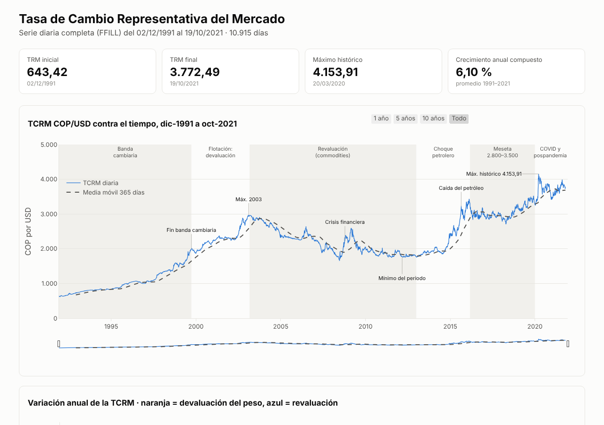
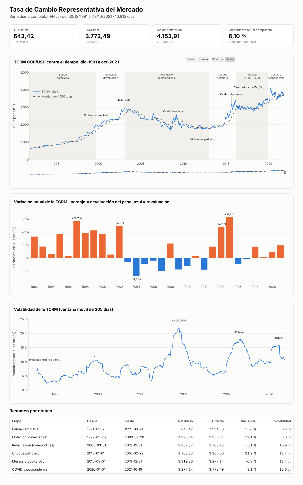

# TRM Colombia 1991–2021 · Análisis interactivo

Análisis de 30 años de la **Tasa de Cambio Representativa del Mercado (COP/USD)**: tendencia, variación anual y volatilidad. La serie se divide en seis etapas de la historia cambiaria colombiana.

**[▶ Ver el análisis en vivo](https://Sebastian6820.github.io/trm-colombia-1991-2021/)**

## Cifras clave

| TRM inicial | TRM final | Máximo histórico | Crecimiento anual compuesto |
|---|---|---|---|
| 643,42 (02/12/1991) | 3.772,49 (19/10/2021) | 4.153,91 (20/03/2020) | 6,10 % |

## Qué muestra

1. **Serie diaria y media móvil de 365 días.** Las seis etapas aparecen sombreadas y los hitos están anotados (fin de la banda cambiaria, crisis de 2008, caída del petróleo, COVID). Incluye botones de rango (1, 5 y 10 años, o todo) y un selector deslizante.
2. **Variación anual.** Las barras naranjas son años de devaluación del peso y las azules, de revaluación. Los extremos son +31,6 % en 2015 y −14,0 % en 2004.
3. **Volatilidad anualizada** con ventana móvil de 365 días frente al promedio histórico de 9,9 %. Los picos coinciden con la crisis de 2008, el choque petrolero y el COVID.
4. **Resumen por etapas**, con la TRM de inicio y fin, la variación anual y la volatilidad de cada régimen.

| Etapa | Periodo | Var. anual | Volatilidad |
|---|---|---|---|
| Banda cambiaria | 1991 – 1999 | 15,6 % | 6,5 % |
| Flotación: devaluación | 1999 – 2003 | 12,1 % | 6,6 % |
| Revaluación (commodities) | 2003 – 2012 | −5,1 % | 10,9 % |
| Choque petrolero | 2013 – 2016 | 21,9 % | 11,7 % |
| Meseta 2.800–3.500 | 2016 – 2019 | −0,3 % | 11,4 % |
| COVID y pospandemia | 2020 – 2021 | 8,1 % | 13,6 % |

## Hallazgos

- El peso se devaluó casi seis veces en 30 años, pero no de forma continua. Entre 2003 y 2012 hubo una larga revaluación impulsada por el auge de las materias primas.
- La volatilidad pasó de cerca del 6 % durante la banda cambiaria a más del 13 % en la etapa reciente. El mercado cambiario es hoy más sensible a los choques externos.
- Los dos saltos más fuertes del dólar (2014–2015 y 2020) responden a choques externos: el petróleo y la pandemia.

## Metodología

- La serie oficial diaria se completó para los días sin dato (fines de semana y festivos) con *forward fill*, lo que da 10.915 días continuos.
- Variación anual: cambio porcentual entre el cierre de cada año y el del año anterior.
- Volatilidad: desviación estándar móvil de 365 días de los retornos diarios, anualizada.
- Crecimiento anual compuesto: (TRM final / TRM inicial)^(1/años) − 1.

## Tecnología

Python (pandas) para limpieza y cálculos, y **Plotly** para los gráficos interactivos. El HTML es autocontenido porque lleva la librería embebida: funciona sin conexión, solo con abrir `index.html`.

## Autor

**Sebastián** · [GitHub](https://github.com/Sebastian6820) · [LinkedIn](https://www.linkedin.com/in/sebastianmartineztinoco-dataanalyst~)
